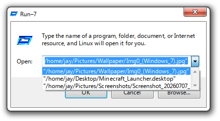
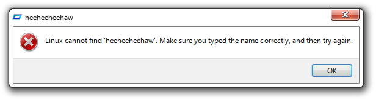

# Run–7


A recreation of Window 7's Run Application

## About this project
This is an accurate-as-possible recreation of Window 7's Run Application in Qt Quick and Python. It is based on inspecting the original application's components with Inspect.exe, along with comparing screenshots pixel-by-pixel in GIMP.

I made this in order to familiarise myself with creating a simple Qt Quick application. It taught me how to create windows and style them with a theme in QML, how to write a backend for more important function calls in Python, and bridging them together via slots and signals. It also helped me learn the standard structure of Python projects which are distributed, like specifying package managers, a pyproject.toml and a versioning system.

Originally made for the Hackclub Program [Macondo](https://macondo.hackclub.com/).

## Features
- Running applications, opening websites and viewing files
- A browse dialog to precisely choose an application
- A recreation of Window 7's Aero theme for increased accuracy
- Reactive text based on the OS you are using
- Run History showing the last 'n' items
- A config to customise parts of the application

## Gallery



## Running
- Download the binary from the [latest release](https://github.com/jayrickaby/run-7/releases/latest), or [build it from source](#building-from-source)
- You may need to give executable permissions via `chmod +x ./run-7` in terminal, or by adjusting the properties in the right-click context menu.
- Double click the executable, or use `./run-7` in the terminal, to run.
Requirements: [PySide6](https://pypi.org/project/PySide6/)


## Building from Source
```
git clone https://github.com/jayrickaby/run-7.git && cd run-7

# Run the build script
chmod +x ./build.sh && ./build.sh 

# Run the application
chmod +x ./build/run-7 && ./build/run-7 
```
Requirements: [uv](https://docs.astral.sh/uv/)

## Disclaimer
Microsoft® Windows™ is a registered trademark of Microsoft® Corporation. This name is used for referential use only, and does not aim to usurp copyrights from Microsoft. Microsoft Ⓒ 2026 All rights reserved. All resources belong to Microsoft Corporation.
